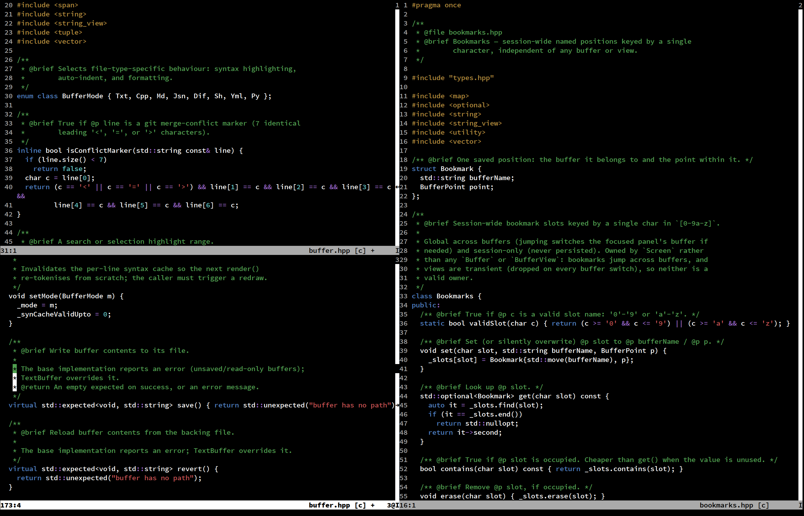

# cx

AI-slopped, simple, terminal text editor. Esc-? for help text. No configuration.



Three panels editing cx's own source, with line-number gutters and C-mode syntax highlighting. The focused panel
(bottom left) has three cursors active — note the reverse-video cells on the comment lines and the `3@I` on its
modeline. See [The Modeline](#the-modeline) for what the rest of that row means.

## Building

```sh
cmake -B build
cmake --build build
```

API documentation can be generated with Doxygen (optional):

```sh
cmake --build build --target docs   # output in build/docs/html
```

## Usage

```sh
./build/cx [OPTION]... [file[:LINE]|directory ...]
```

Options: `-h`/`--help` prints a short usage summary; `--version` prints the git commit (with `-dirty` for uncommitted
changes), build date, compiler, build type and compile flags. `--theme=dark` (the default) picks colours for a dark
terminal background with light text, `--theme=light` for a light background with dark text. `--` ends option parsing,
so `cx -- -notes.txt` opens a file whose name starts with `-`; any other unrecognised option is an error.

Open one or more files for editing, or directories for browsing. With no arguments, cx starts with an empty scratch buffer.

A trailing `:LINE` on a path argument (e.g. `cx src/foo.cpp:42`) opens the file at the given 1-based line. Only the final argument's line number is honoured.

If stdin is a pipe (e.g. `cmd | cx`), cx reads it into a `*stdin*` scratch buffer.

## Features

- **UTF-8 support** — full Unicode text editing and display, including CJK wide characters and emoji (drawn two columns wide). Combining marks (accents, emoji variation selectors) stay attached to the character before them. Invisible format characters — zero-width space, joiners, BOM, direction marks and bidi controls, soft hyphen — are shown as dimmed escapes such as `\u200b`, so they can't hide in the text. The C1 control characters (U+0080–U+009F, which a terminal may act on) and the line/paragraph separators are escaped the same way. Widths follow Unicode 15.1, matching xfce4-terminal.
- **Multiple buffers** — open, switch between, and kill buffers; MRU-ordered buffer switching with tab completion and filesystem path completion. The Ctrl-o switch prompt defaults to the previous buffer; typing `*name*` creates (or finds) a scratch buffer of that name.
- **Buffer list** — interactive tree view of open buffers (collapsed single-child directories)
- **Find** — smart search: case-insensitive when the pattern is all lowercase; digits and special characters in the buffer are transparently skipped unless they appear in the search pattern. The search runs on Enter (highlight visible for ~3 s); Ctrl-F again advances to the next match while re-prompting for a new search string. Inside the prompt Ctrl-F / Ctrl-R also advance the previous search forward/backward without leaving the prompt. An empty prompt re-uses the last pattern (shown as a dim hint).
- **Find and replace** — `Esc-%` prompts for a pattern and replacement, then walks forward through matches asking `y`/`n`/`!`/`q` per hit. `!` finishes the rest without prompting. Matching is exact (case-sensitive, no fuzzy skipping) — unlike Find, which uses smart matching for navigation.
- **Find in files** — `Esc-g` searches a whole tree and lists the hits in a read-only `*grep*` buffer as `path:line: text`. Inside a git work tree it runs `git grep` from the repository root, so `.gitignore` is honoured and build output stays out of the results (matches are limited to tracked files); otherwise it runs `grep -r` from the current buffer's directory, or from the browsed directory when a directory buffer is open. `Enter` on a result opens that file at that line in the other panel — splitting vertically first if only one panel is open — so the result list stays visible while you walk the matches. Searches over 10 s offer the same "Kill? y/n" prompt as other external commands.
- **Mark and region** — set/clear mark, cut/copy/paste with a multi-entry paste ring and paste cycling
- **Terminal paste** — text pasted by the terminal (Ctrl-Shift-V, Shift-Insert) is inserted as it is, as a single edit and one undo step: no auto-indent or Tab formatting is applied to it. A prompt takes the first line of a paste; read-only buffers ignore it. This uses bracketed paste, which every current terminal supports; without it a paste still arrives as typed keys. Should the terminal's end-of-paste marker get lost, the paste ends after 2 s without input and the status line says so.
- **Case conversion** — `Esc-U` / `Esc-L` / `Esc-C` uppercase / lowercase / capitalize the active region, or the word at (or next to the right of) the cursor when no mark is set. ASCII-only: non-ASCII letters are left unchanged, and the edit never splits a multi-byte UTF-8 character.
- **Reflow** — `Esc-q` refills the paragraph (or every paragraph in the region) to 80 columns, keeping list bullets and indentation. In Markdown buffers it formats GFM pipe tables instead: every column separator is aligned (honouring `:--` / `:-:` / `--:` alignment), and the column under the cursor is wrapped so the table fits in 80 columns. A wrapped cell continues in rows whose first cell is empty, so the first column and the header row are never wrapped. A wrapped column is at least 20 columns wide when its text needs that much. Code spans and links are never split. Tables inside block quotes (`> | a | b |`) work too. With a region active, every table it touches is aligned as a whole. Fenced code blocks are never reflowed or reformatted.
- **System clipboard integration (X11)** — Cut and Copy publish the region to the X11 CLIPBOARD selection (via `xclip` or `xsel` if installed); Paste reads the CLIPBOARD when it differs from the top of the internal ring, so external Ctrl-C from other apps becomes pasteable. The active mark region is also mirrored to the PRIMARY selection after every keystroke (so other apps can middle-click-paste it), and middle-click inside the editor pastes the PRIMARY selection back at the cursor. All X11 integration is silently a no-op when no graphical session is available.
- **Word and paragraph navigation** — move by word, paragraph, or go to a specific line (the prompt also accepts `last` to jump to end of buffer)
- **Block navigation** — `Ctrl-N` / `Ctrl-B` jump between blocks: hunk headers (`@@ ... @@`) in diff buffers, and conflict regions (`<<<<<<<`/`=======`/`>>>>>>>`) in any buffer that contains them.
- **Conflict-marker highlighting** — git merge conflict regions are detected on load/revert/save and rendered with distinct backgrounds for the "ours", divider, and "theirs" sections, regardless of the buffer's syntax mode.
- **Chunk deletion** — delete contiguous runs of whitespace or non-whitespace in either direction
- **Line wrapping** — toggle soft line wrap on/off
- **Whitespace display** — toggle visible whitespace markers (spaces, tabs, newlines)
- **Save / Save As** — write to the backing file or choose a new path. Saving prompts for confirmation if the file no longer exists on disk, or if its mtime/size has changed since load (external-modification guard).
- **Revert** — reload a buffer's contents from disk with confirmation. When you switch to a buffer whose file another program changed since it was loaded or saved, the status line says so (once per change)
- **Auto-indent** — pressing Enter in C/C++, JSON, or Python modes preserves the leading-spaces indent of the previous line.
- **Overwrite mode** — the `Insert` key toggles between insert and overwrite editing (per buffer). In overwrite mode typing replaces the character under the cursor instead of pushing it right; at end of line it appends, and Enter always inserts a newline. The active mode shows as `I`/`O` on the modeline and as the cursor shape (steady block for insert, steady bar for overwrite).
- **Line-ending detection** — files loaded with CRLF or lone-CR endings prompt to translate to `\n`; mixed-ending files surface a warning. Acknowledged once per load.
- **Undo / version history** — `Ctrl-u` enters a read-only history mode: `[` and `]` step through earlier/later versions, `Enter` commits the selected version as the new live state, `Esc-Esc` cancels and returns to the latest. (Pressing `Ctrl-u` again is equivalent to `Enter`.) History survives save and revert.
- **Directory browser** — open directories to see files with permissions, owner, group, and size; navigate into subdirectories; toggle hidden files; mark and delete entries; rename entries; create subdirectories. The listing is re-read each time the directory is opened again (so `Enter` on `.` refreshes it)
- **Split panels** — split the terminal vertically or horizontally into up to 6 independent panels, each with its own cursor and viewport; focus panels by number or switch to the most recently used panel with C-x o
- **Mouse support** — left-click positions the cursor (and focuses a non-focused panel); left-drag selects a region (the `mark`→cursor span, mirrored to the X11 PRIMARY selection), autoscrolling when dragged past the top or bottom of a panel. Middle-click pastes the X11 PRIMARY selection at the cursor. The wheel scrolls the panel under the pointer. While mouse tracking is on, the terminal's own right-click context menu and selection are suppressed — hold `Shift` while clicking to bypass tracking, or toggle tracking off with `C-x m`.
- **Long-running command kill prompt** — external commands launched via Esc-f, Tab-format, or Ctrl-p that take longer than 10 s show a "Kill? y/n" prompt so a hung formatter or pipe never freezes the editor. Killing stops everything the command started, not just the command itself.
- **Modeline** — the bottom row of each panel shows `line:col`, the active prompt or status message, the buffer's display name, its mode, a `+` when modified, the cursor count, and an `I`/`O` insert/overwrite indicator. See [The Modeline](#the-modeline) for the full breakdown.
- **Terminal title** — set to `cx@<cwd>` on startup so cx tabs are easy to identify.
- **Signals and crashes** — `SIGTERM` (a plain `kill`) is taken as `Esc-c`: the editor asks about each modified buffer before it exits. A second `SIGTERM` while it is still asking makes an emergency save and exits, and so does the terminal's input being closed. `SIGHUP` (the terminal went away), `SIGINT` and `SIGQUIT` end the editor at once, also when it is not responding, and make an emergency save on the way out; so does a crash (`SIGSEGV`, `SIGABRT`, …), on a best-effort basis. An emergency save never writes a file itself: every modified buffer that has a file goes to a copy next to it, `<file>.unsaved-<UTC time>` (e.g. `notes.md.unsaved-20261115T143502Z`), and the file stays as it was last saved, for you to compare and pick. The terminal is restored first and then lists what happened, one line per buffer: `cx: unsaved <file> written to <copy>`, `cx: could not save <file>: <reason>`, or `cx: discarded <buffer>` for a modified buffer that has no file.
- **Error log** — uncaught exceptions, clipboard failures and the like are appended to `~/.cx-errors` for post-mortem inspection (never surfaced as UI noise).

## The Modeline

The bottom row of every panel is its modeline, drawn in reverse video — bold on the focused panel, dim on the others
(the screenshot above shows three of them). It has a left segment that tracks what you are doing, and a
right-aligned segment that describes the buffer:

```
3:17 | Created 3 cursors                                          notes.md [md] +   3@I
└──── left segment ────┘                                          └── right segment ──┘
```

Reading that example: the cursor is on line 3, character 17; the last thing that happened was `Esc-*` creating three
cursors; the buffer is `notes.md` in Markdown mode with unsaved changes, and has 3 cursors active in insert mode.

### Left segment

- **`3:17`** — cursor position: 1-based line, then 1-based column counted in *characters*, not bytes, so a line of
  CJK or accented text reports the column you can actually see.
- **`| v 4/12  2026-07-19 15:04:22  [/] step  Ctrl-U commit`** — the history-mode badge: which version you are on out
  of how many, when it was captured, and the keys to step or commit.
- **`| Find: rege`** — the active prompt and what you have typed so far, followed by any completion hint in dim text.
  The prompt cursor is drawn in normal video against the bar. Inside a prompt, `←`/`→` and `Home`/`End` move the
  cursor (`Ctrl-←`/`Ctrl-→` by word), `Bksp`/`Delete` delete a character (`Ctrl-Bksp`/`Esc-Bksp`/`Ctrl-Del` a chunk),
  and `↑`/`↓` recall earlier input. In prompts with completion, `Tab` cycles the matches and `→` at the end of the
  input accepts the current one. `Ctrl-Space` sets the mark and cursor movement extends the selection (shown
  underlined); `Ctrl-W` / `Esc-w` cut / copy it and `Ctrl-Y` / `Esc-y` paste / cycle, all through the same paste ring
  and X11 clipboard as the buffers. Only the first line of a multi-line entry is pasted. Since a bare `Esc` cancels the
  prompt, the `Esc` chords need to be typed as `Alt-w` / `Alt-y` (or Esc pressed quickly before the key).
- **`| Created 3 cursors`** — the most recent status message. It stays up until the next keypress redraws the
  modeline.

Only one of the prompt and the status message is ever shown, and only on the focused panel; the cursor position and
the history badge appear on every panel.

### Right segment

- **`notes.md`** — the buffer's display name: the bare filename when that is unambiguous, otherwise the full path.
  Built-in buffers use a `*name*` form: `*1*` (the scratch buffer cx opens with), `*stdin*`, `*help*`, `*buffers*`,
  `*paste ring*`, and `*grep*`.
- **`[md]`** — the buffer mode, one of `[txt]` `[c]` `[md]` `[jsn]` `[dif]` `[sh]` `[yml]` `[tml]` `[py]`. It drives syntax
  highlighting, auto-indent, and formatting, and is changed with `Esc-m`.
- **`+`** — unsaved changes. Blank means the buffer matches what is on disk.
- **`3@`** — the cursor count, while multiple cursors are active. Blank with a single cursor; `***@` above 999.
- **`I` / `O`** — insert or overwrite mode, toggled with the `Insert` key. The terminal cursor shape follows it too:
  a block for insert, a bar for overwrite.

Read-only buffers — help, the directory browser, the buffer list, the paste ring, the grep results, and any buffer
being browsed in history mode — show the name alone. The mode, cursor count and `I`/`O` are all omitted, since none of them apply to a
buffer you cannot type into.

The count and `@` occupy a fixed-width field, so the `I`/`O` never changes column as cursors come and go:

```
notes.md [md] +   3@I     modified, 3 cursors, insert mode
notes.md [md] +     I     modified, single cursor, insert mode
notes.md [md]       O     saved, single cursor, overwrite mode
```

### When space runs short

The modeline never wraps or spills past its panel. As the panel narrows, it degrades in this order: the buffer name is
truncated from the front with a leading `…`; then the name is dropped entirely, keeping only the `I`/`O` block; then
that goes too. A prompt long enough to fill the whole line is truncated from the back.

### Not on the modeline

Two nearby cues are easy to mistake for part of it:

- A dim digit in the **top**-right corner of a panel is its panel number (shown only when more than one panel is open),
  for `C-x 1`…`C-x 6`.
- The rightmost column of the panel body is the wrap/scroll gutter: `↵` marks a soft-wrapped line, `↠` marks a line
  whose content extends past the right edge in no-wrap mode.

## Keyboard Shortcuts

### Files & Buffers

| Key     | Action                                          |
|---------|-------------------------------------------------|
| Esc-?   | Show help (press again to dismiss)              |
| Esc-c   | Exit (prompts to save modified buffers)         |
| Ctrl-o  | Switch to buffer / open file (defaults to MRU)  |
| Esc-b   | Buffer list                                     |
| Esc-d   | Directory browser                               |
| Ctrl-s  | Save file                                       |
| C-x k   | Kill buffer                                     |
| Esc-r   | Revert buffer from file                         |
| Ctrl-u  | Undo / version history                          |
| Esc-x   | Execute command by name (substring completion)  |
| q       | Dismiss read-only overlay (help / list / ring)  |
| Esc-Esc | Dismiss overlay; otherwise clear mark           |

### Regions & Edit

| Key        | Action                                |
|------------|---------------------------------------|
| Ctrl-Space | Set / clear mark                      |
| Esc-Esc    | Clear mark                            |
| Ctrl-w     | Cut region                            |
| Esc-w      | Copy region                           |
| Ctrl-y     | Paste                                 |
| Esc-y      | Paste cycle                           |
| Esc-p      | Paste ring                            |
| Esc-f      | Format buffer/region (C/C++)          |
| Ctrl-p     | Pipe region through command           |
| Esc-;      | Toggle line comment (C/C++, sh, py, yml, tml) |
| Esc-q      | Reflow paragraph / md table (80 cols) |
| Esc-U      | Uppercase region/word                 |
| Esc-L      | Lowercase region/word                 |
| Esc-C      | Capitalize region/word                |
| Tab        | Format line (C/C++)                   |

### Search & Movement

| Key             | Action                                                     |
|-----------------|------------------------------------------------------------|
| Ctrl-f          | Find forward                                               |
| Ctrl-r          | Find backward                                              |
| Esc-%           | Find and replace                                           |
| Esc-X           | Regex find forward (ECMAScript / `std::regex` syntax)      |
| Esc-Y           | Regex find and replace (`$0..$9`/`$&` back-references)     |
| Esc-g           | Find in files (grep)                                       |
| Arrows          | Move cursor                                                |
| Ctrl-Left/Right | Move by word                                               |
| Ctrl-Up/Down    | Move by paragraph                                          |
| Ctrl-g          | Go to line (accepts a number, or `last` for end of buffer) |
| Ctrl-n          | Next block (`@@` hunk in diff buffers / conflict marker)   |
| Ctrl-b          | Prev block (same)                                          |
| Ctrl-l          | Recenter cursor (cycles middle / top / bottom of screen)   |
| PgUp / PgDn     | Page up / down (half screen)                               |
| Home / End      | Start / end of line                                        |
| Ctrl-Home/End   | Start / end of file                                        |

Regex search matches within a single line and treats the text before the
cursor as context, so `^` only matches at a real line start. Patterns that
can match empty text (`x*`, `^`, `$`, `\b`) work for find, skip and
replace-all.

**Known limitation:** `std::regex` backtracks, and a regex search cannot be
interrupted. Nested quantifiers such as `(a*)*b`, or `.*x` on a very long
line, can take exponential or quadratic time and freeze the editor, and
the only way out is killing it (which loses unsaved changes). Save before
running an untested pattern on a large file.

### Multiple cursors

Several cursors edit in parallel: typing, Enter, Tab, Backspace, Delete,
chunk delete and paste all apply at every cursor, and one keystroke is one
undo step no matter how many cursors are active. Arrow, word and Home/End
movement moves every cursor by the same rule.

Secondary cursors show as reverse-video cells, and the live cursor count
sits in front of the insert/overwrite indicator at the right of the
modeline as `3@I`. The field is blank with a single cursor and reserves
three digit columns, so the indicator never shifts as cursors come and go;
counts above 999 show as `***@`.

| Key            | Action                                                    |
|----------------|-----------------------------------------------------------|
| Esc-*          | Cursor at the end of every occurrence of the word at point |
| Ctrl-Shift-Down| Add cursor on the line below, at the same column           |
| Ctrl-Shift-Up  | Add cursor on the line above, at the same column           |
| Esc-Esc        | Back to a single cursor                                    |

The headline workflow — rename every occurrence of a word — is `Esc-*`,
then `Ctrl-Bksp` to kill the word at every cursor, then type the
replacement.

With a region marked, `Esc-*` matches the region's text literally instead
of whole words. Any other command (find, goto, mouse click, cut/copy,
comment toggle, history mode, …) collapses back to a single cursor first.

Some terminals and tmux configurations swallow `Ctrl-Shift-Up/Down`; both
actions are also reachable by name through `Esc-x`.

### Bookmarks

Session-wide named positions, global across buffers (not persisted across restarts).

| Key   | Action                                                       |
|-------|---------------------------------------------------------------|
| C-x b | Set bookmark (prompts for a slot: `0-9` or `a-z`)              |
| C-x j | Jump to bookmark (prompts for a slot; shows occupied slots)    |

### Bracket matching

Pressing `?` while the cursor is on a bracket jumps to its match. Available
in every mode:

- **Cpp** (`.c`, `.h`, `.cpp`, `.hpp`, …): matches `()[]{}` and template
  `<>`. Plain comparison operators `<`/`>` are not matched. Brackets in
  strings, character literals and comments are skipped.
- **Jsn** (`.json`): matches `[]` and `{}`. Brackets inside strings are
  skipped.
- **Md / Dif / Sh / Yml / Tml / Py / Txt** (and any buffer with no specific
  mode): matches `()[]{}` only. `<` and `>` are treated as ordinary
  characters.

If the cursor is not on a bracket, `?` is inserted normally.

### C mode

| Key | Action                             |
|-----|------------------------------------|
| Tab | Format current line (clang-format) |

### Directory Browser

These shortcuts are active when viewing a directory listing.

| Key   | Action                          |
|-------|---------------------------------|
| Enter | Open file / enter directory     |
| h     | Toggle hidden files (dotfiles)  |
| d     | Mark / unmark for deletion      |
| x     | Delete marked items             |
| r     | Rename selected entry           |
| m     | Make subdirectory               |

### Display

| Key   | Action                                                                              |
|-------|-------------------------------------------------------------------------------------|
| Esc-s | Toggle whitespace                                                                   |
| Esc-l | Toggle line wrap                                                                    |
| Esc-_ | Toggle highlight on the cursor's line                                               |
| Esc-# | Toggle line-number gutter                                                           |
| Esc-m | Set buffer mode (accepts `txt`/`text`, `c`/`cpp`/`c++`, `md`/`markdown`, `jsn`/`json`, `dif`/`diff`/`patch`, `sh`/`shell`/`bash`, `yml`/`yaml`, `tml`/`toml`, `py`/`python`) |
| Insert | Toggle insert/overwrite mode                                                       |

### Panels

| Key      | Action                 |
|----------|------------------------|
| C-x v    | Split panel vertical   |
| C-x h    | Split panel horizontal |
| C-x .    | Close panel            |
| C-x o    | Other panel (MRU)      |
| C-x 1..6 | Focus panel 1..6       |
| C-x m    | Toggle mouse tracking  |

### Deletion

| Key       | Action                     |
|-----------|----------------------------|
| Bksp      | Delete before cursor       |
| Ctrl-Bksp | Delete chunk before cursor |
| Esc-Bksp  | Delete chunk before cursor |
| Delete    | Delete at cursor           |
| Ctrl-Del  | Delete chunk at cursor     |
| Ctrl-k    | Delete current line        |

### History mode

Active after pressing `Ctrl-u` on a buffer with edit history.

| Key     | Action                                |
|---------|---------------------------------------|
| `[`     | Step to older version                 |
| `]`     | Step to newer version                 |
| Enter   | Commit selected version               |
| Ctrl-u  | Commit selected version               |
| Esc-Esc | Cancel and return to latest           |

### Prompts

When a prompt is active (Find, Save As, Switch Buffer, Go to line, …):

| Key         | Action                                                         |
|-------------|----------------------------------------------------------------|
| Enter       | Accept input                                                   |
| Esc         | Cancel prompt                                                  |
| Up / Down   | Navigate per-prompt input history                              |
| Tab         | Cycle completion candidates (Save As, Switch Buffer)           |
| Right arrow | Accept current completion (and descend into directory if any)  |
| Bksp        | Remove one character (full UTF-8 codepoint)                    |
| `y/n/!/q`   | Replace prompt: yes / skip / all-rest / quit                   |
| Ctrl-f      | Find prompt: advance forward without leaving the prompt        |
| Ctrl-r      | Find prompt: advance backward without leaving the prompt       |
